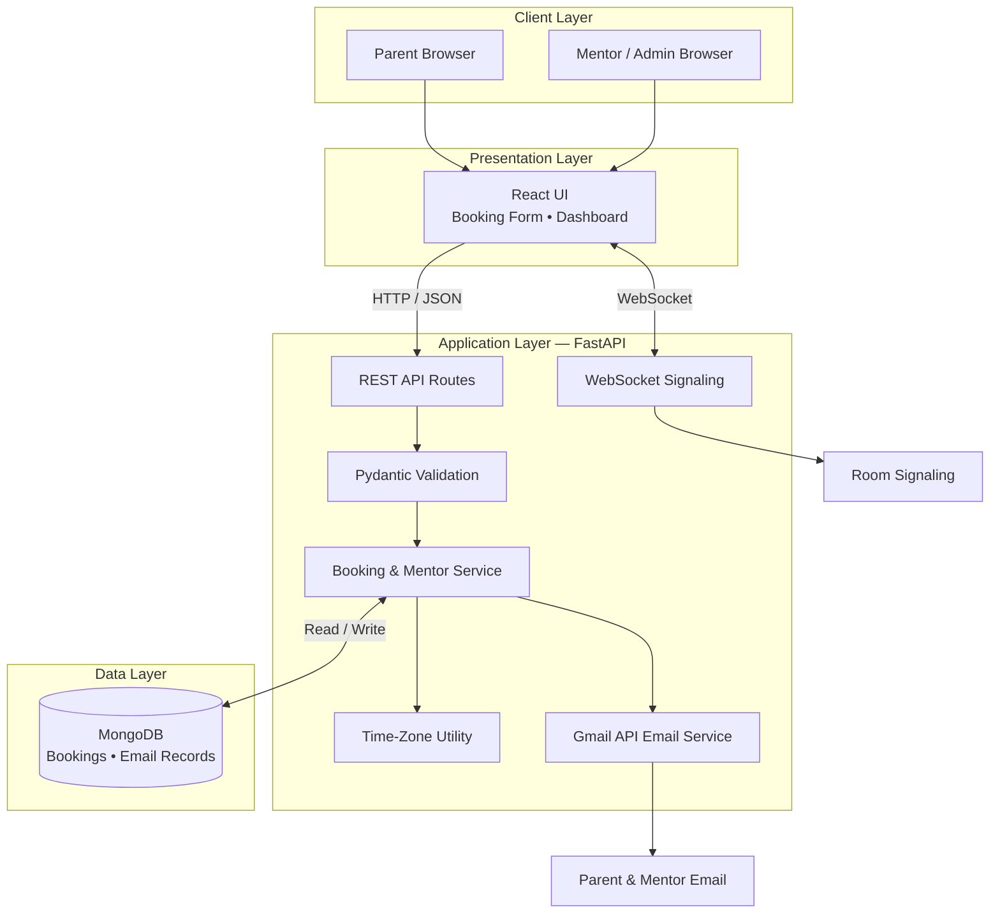
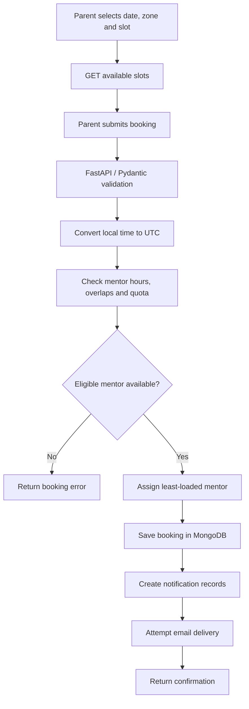
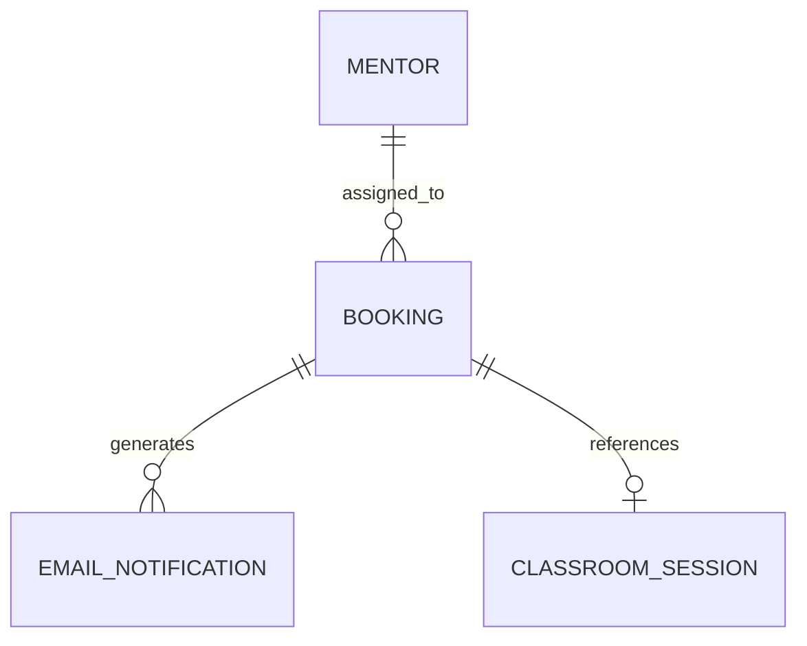

# Codeyoung Trial Class Appointment Booking System

A full-stack booking application built with **Python, FastAPI, React, and MongoDB**. Parents select a convenient local time; the backend validates availability, converts the appointment to UTC, assigns an eligible mentor, stores the booking, and prepares notifications.

## 1. Problem Statement and Solution

Codeyoung parents need to book trial coding classes before enrolling. The system must coordinate parents in different time zones with mentors based in India, handle daylight saving time (DST), avoid conflicting appointments, and enforce daily mentor capacity.
**Solution:** A React interface communicates with FastAPI APIs. The backend validates requests, converts local appointment times to UTC, checks availability and capacity, assigns the least-loaded eligible mentor, persists booking data in MongoDB, and prepares parent/mentor notifications.
**System scale**
- 10 configured mentors.
- Maximum 2 classes per mentor per IST calendar day.
- Maximum theoretical capacity: 20 classes per day.
- Trial class duration: 1 hour.
- Parent time zones include US Eastern/Central/Mountain/Pacific and UK; mentors use `Asia/Kolkata`.

## 2. Key Features

- Slot availability by date/time zone; least-loaded eligible mentor assignment.
- Working-hour, overlap, and daily-capacity checks.
- UTC timestamps with parent-local and mentor-local display.
- MongoDB booking/notification records and Gmail API integration.
- Mentor capacity dashboard, booking ledger, email logs, and classroom signaling.
- Development seed/reset endpoints.

> Email records do not prove inbox delivery. WebSocket signaling alone does not prove a complete audio/video classroom. Verify both end to end before making production-readiness claims.

## 3. Technology Stack and Architecture

| Layer | Technology | Responsibility |
|---|---|---|
| Frontend | React 18, ReactDOM, HTML/CSS, Tailwind CDN, Babel Standalone | Booking and dashboard UI |
| Backend | Python, FastAPI, Uvicorn | API routes and application server |
| Validation | Pydantic | Request/response models |
| Database | MongoDB, PyMongo | Persistent booking and notification records |
| Time zones | `zoneinfo`, IANA time-zone database, JavaScript `Intl` | UTC conversion, DST and local display |
| Email | Gmail API, OAuth 2.0 | Notification send attempts |
| Real-time | FastAPI WebSocket | Classroom signaling relay |
| Testing | Pytest | Scheduling, capacity and time-zone tests |

### Standard system architecture



### Main project files

```text
codeyoung-booking/
├── backend/
│   ├── app/
│   │   ├── main.py              # FastAPI routes and WebSocket
│   │   ├── models.py            # Pydantic data models
│   │   ├── mentor_service.py    # Slots, assignment, capacity, persistence
│   │   ├── timezone_utils.py    # Time-zone and DST utilities
│   │   ├── database.py          # MongoDB connection
│   │   └── email_service.py     # Gmail API integration
│   ├── tests/
│   │   ├── test_mentor_assignment.py
│   │   └── test_timezone.py
│   └── requirements.txt
├── frontend/public/
│   ├── index.html               # Frontend shell
│   └── app.js                   # React UI
├── authorize_gmail.py
├── build_frontend.py
├── start.ps1
├── start.bat
├── .env                         # Local secrets; do not commit
└── README.md
```

The supplied frontend uses CDN-loaded React/Babel. A `package-lock.json` is present in the ZIP, but no `frontend/package.json` is included, so the documented startup method uses FastAPI to serve the frontend.

## 4. Prerequisites and Setup

**Requirements:** Windows PowerShell, Python 3.10+, MongoDB (Atlas or local), and Git. Gmail OAuth credentials are optional unless testing email.
Frontend will run on : http://localhost8000

### Configure MongoDB

Create `.env` in the project root. `MONGODB_URI` is required; `MONGODB_DATABASE` is optional and defaults to `codeyoung_booking`.

```dotenv
MONGODB_URI=mongodb+srv://<username>:<password>@<cluster>/<database>
MONGODB_DATABASE=codeyoung_booking
```

### Optional Gmail setup

Configure the Google OAuth desktop client and run the helper from the project root:

```powershell
.\backend\.venv\Scripts\python authorize_gmail.py

## 5. Running the Application

### Option A — startup script

```powershell
.\start.ps1
``

### Option B — run FastAPI directly

```powershell
$env:PYTHONPATH = "backend"
.\backend\.venv\Scripts\python -m uvicorn app.main:app --host 0.0.0.0 --port 8000 --reload
```
Open:
- App: `http://localhost:8000`
- API docs: `http://localhost:8000/docs`
- OpenAPI schema: `http://localhost:8000/openapi.json`
- Health: `http://localhost:8000/api/health`

### Seed demo bookings

```powershell
Invoke-RestMethod -Method Post `
  -Uri "http://localhost:8000/api/seed-mock-bookings?date=2026-10-15&count=18"
```

The endpoint attempts to create the requested number of mock bookings, subject to capacity and slot availability; it may create fewer.

### Reset demo data

**Warning:** This deletes documents from the `bookings` and `emails` collections. Use only with a disposable development database.

```powershell
Invoke-RestMethod -Method Post -Uri "http://localhost:8000/api/reset"
```

## 6. Core Logic and API Documentation

### Booking workflow



### API endpoints

| Method | Endpoint | Purpose |
|---|---|---|
| `GET` | `/api/health` | Health and booking counts |
| `GET` | `/api/timezones` | Supported zones and current offset/DST |
| `GET` | `/api/slots?date=YYYY-MM-DD&timezone=IANA_ZONE` | Available slots |
| `POST` | `/api/bookings` | Create a booking |
| `GET` | `/api/bookings` | List bookings |
| `GET` | `/api/mentors?ist_date=YYYY-MM-DD` | Mentor roster and capacity |
| `GET` | `/api/emails` | Notification records |
| `GET` | `/api/class/{room_id}?booking_id=...` | Classroom metadata |
| `POST` | `/api/seed-mock-bookings?date=YYYY-MM-DD&count=18` | Seed demo bookings |
| `POST` | `/api/reset` | Delete booking and email records |
| WebSocket | `/ws/classroom/{room_id}` | Classroom signaling relay |

Check `http://localhost:8000/docs` for the exact schemas exposed by your running version.
For the exact request fields and response schemas, open `http://localhost:8000/docs`. Use a currently available slot when testing; sample dates are illustrative. A full or unavailable slot may return HTTP `409 Conflict`.

## 7. Database Design and Testing

### MongoDB collections

| Collection | Purpose |
|---|---|
| `bookings` | Parent/student details, assigned mentor, UTC start/end, time zones, meeting link, status |
| `emails` | Booking reference, recipient, role, subject/body and timestamp |

The mentor roster is configured in application code, not stored in a separate mentors collection.



This is a logical relationship diagram; MongoDB does not enforce relational foreign keys.

### Run tests

```powershell
$env:PYTHONPATH = "backend"
.\backend\.venv\Scripts\python -m pytest -v
```

Tests cover mentor count and quota, assignment/capacity behavior, notification-record creation, US/UK summer and winter offsets, IST offset, and date-boundary conversion.

### Manual verification checklist

- [ ] App and `/api/health` load successfully.
- [ ] A valid booking is stored in MongoDB.
- [ ] Unavailable/conflicting slots are rejected.
- [ ] Per-mentor limit and 20-booking ceiling work.
- [ ] Parent and mentor times are correct across DST seasons.
- [ ] Test email arrives in a controlled inbox.
- [ ] Classroom signaling/media work in two browsers if enabled.
Do not claim tests pass until you have run them. Unit tests do not prove real email delivery, race-free concurrency, or a complete live classroom.

## 8. Security, Limitations, and Future Improvements

### Security

- Never commit `.env`, MongoDB credentials, `gmail_credentials.json`, `gmail_token.json`, virtual environments, or caches; add them to `.gitignore`.
- Rotate any credentials exposed in Git history.
- Restrict wildcard CORS and protect/disable unauthenticated seed/reset endpoints.
- Add authentication/authorization for admin views and classroom rooms.
- Use HTTPS and production meeting URLs; a room ID is not authentication.

### Known limitations

- DST ambiguous/nonexistent times need explicit validation.
- In-memory availability checks can race under concurrent requests.
- Gmail API/OAuth dependencies need adding to `requirements.txt`.
- Email logs do not prove inbox delivery; WebSocket signaling does not prove complete WebRTC media.
- CDN frontend lacks a conventional npm build; admin/demo routes and permissive CORS need hardening.

### Future improvements

Add DST edge-case validation, atomic reservations, cancellation/rescheduling, role-based access, email retries and delivery tracking, secure WebRTC, a Vite/React build, CI integration tests, monitoring, and deployment configuration.

## 9. Author and License

**Author:** `Aditya Kumar Dhara`  
**GitHub:** `https://github.com/aditya326-stu`
Replace these placeholders before publishing. No `LICENSE` file was present in the supplied ZIP. Add a license only if you have the right to license the project and intentionally choose the terms.
---
